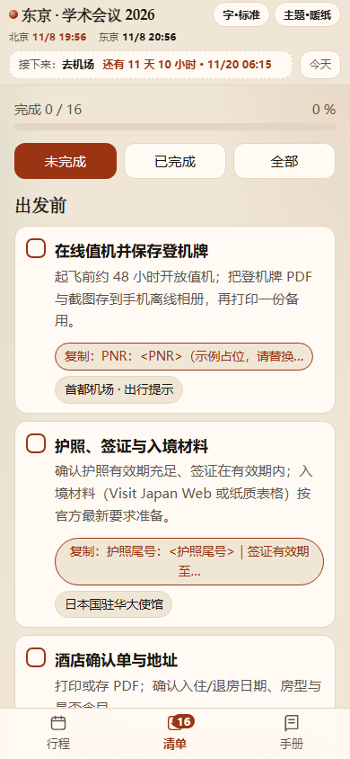

[简体中文](README.md) · **English**

# TripCheat · AI itinerary planner for agents

> Turn scattered flight screenshots, hotel confirmations, conference agendas and travel notes into **one mobile-friendly trip page**:
> **itinerary timeline · checklists · destination handbook** — dual-timezone clocks, map deep links, QR ticket pages, single-file HTML or a static site.

**License** MIT · **Runtime** Node.js ≥ 18 · **Demo** <https://yuanmenghe.github.io/trip-cheat-sheet-skill/> (single-file: <https://yuanmenghe.github.io/trip-cheat-sheet-skill/tripcheat-single.html>) · **Agent Skill** `trip-cheat-sheet`

## What it is

TripCheat is an open-source [Agent Skill](https://agentskills.io). Install it into Claude Code, Codex, Cursor, OpenCode, DSH, OpenClaw or any Agent Skills client, hand the agent your trip materials (screenshots / PDFs / emails / links / chat logs), and it will:

1. **Research** the trip (flights, airport transfers, ticket reservations, payment, emergency numbers…) and separate **verified** from **unverified** facts.
2. **Write** a single `trip.json` against the data contract.
3. **Build** a dual-timezone, offline-capable travel page with the bundled `build.mjs`.
4. **Verify** it with `verify.mjs`, then hand over deployment / sharing instructions.

It is not another “travel guide generator” — it produces something you can **act on at the destination**: when to leave, why the day is ordered this way, what you are giving up, and who to call when things go wrong.

## Screenshots

**Live demo: <https://yuanmenghe.github.io/trip-cheat-sheet-skill/>**

| Itinerary (dual timezone) | Checklist | Handbook |
|---|---|---|
|  |  |  |

> Screenshots come from the real build of the example data (`docs/screenshots/`); desktop, dark theme and ticket pages live in the same folder — try the demo for full interactions.

## Features

- **Three views**: itinerary timeline / checklist / destination handbook, switched from a bottom tab bar; “current / next event” highlighting.
- **Dual timezone**: destination and home clocks, per-event conversions; flights, transfers and cross-day events handled. When destination and home share the same UTC offset, only one time is shown and the header says “same timezone”.
- **Single file or static site**: one self-contained HTML by default (send it, double-click it); `--multi` produces a deployable site with a separate `ticket-<id>.html` per person.
- **QR ticket pages**: enlarged QR, per-person sharing, on-screen hints; the repo ships placeholder QR images only.
- **Map deep links**: Google / Amap / Apple links driven by `meta.mapProvider` (Google directions include the travel mode).
- **Checklists**: check state kept in `localStorage` only; `copy` fields give one-tap copying of addresses, booking numbers and phone numbers.
- **Handbook**: searchable, HTML whitelist-sanitized; the place for “how to get there / how to pay / who to call”.
- **Research standards**: routes verified with map apps (time ranges, last trains, walking distances); restaurants cross-checked with platform ratings + Xiaohongshu real experiences (personal experience only) and confirmed for reservation availability; hotels justified by commute, nightlife/shopping access and cost trade-offs.
- **Business / leisure / mixed tracks**: `meta.tripType` changes **how the trip is planned** — business trips lock meeting/flight hard constraints first, let sightseeing yield, and respect company hotel caps; leisure trips prioritize experience and budget; mixed trips are planned in segments. Reimbursement items are just **checklist reminders** (the agent can ask/record), with no structured fields or totals.
- **Themes and font size**: paper / slate / night themes, four font sizes, follows the system dark mode by default.
- **PWA**: add to home screen (`--no-pwa` to disable).
- **Password gate**: `--gate-password` with client-side SHA-256 check and local memory — casual protection for sharing with friends/family (limits in [deploy.md](skills/trip-cheat-sheet/references/deploy.md)).
- **Zero backend**: pure static output; deploy to GitHub Pages, Cloudflare Pages or any static host.
- **Data contract + validator**: `trip-schema.md` defines the fields; `verify.mjs` checks references, timezones, links, HTML whitelist and runs a privacy scan (phone numbers / long IDs).

## Install

Convention: **one directory per skill, containing a `SKILL.md`**. Copy `skills/trip-cheat-sheet/` into your client's skills directory (keep `references/`, `scripts/`, `templates/`, `examples/` — they are part of the skill).

```bash
git clone https://github.com/YuanMenghe/trip-cheat-sheet-skill.git
```

| Client | Install path (global / project) |
|---|---|
| **Claude Code** | `~/.claude/skills/trip-cheat-sheet/` / `.claude/skills/trip-cheat-sheet/` |
| **Codex** (OpenAI) | `~/.agents/skills/trip-cheat-sheet/` / `.agents/skills/trip-cheat-sheet/` (Codex scans `.agents/skills` upward; trigger with `$` or `/skills`) |
| **Cursor** | `~/.cursor/skills/trip-cheat-sheet/` or `~/.agents/skills/trip-cheat-sheet/` / `.cursor/skills/`, `.agents/skills/` |
| **OpenCode** | `~/.config/opencode/skills/trip-cheat-sheet/` / `.opencode/skills/trip-cheat-sheet/` (also `~/.agents/skills`) |
| **DSH** (DeepSeek Harness) | `~/.agents/skills/trip-cheat-sheet/` (`%USERPROFILE%\.agents\skills\` on Windows) |
| **OpenClaw** | `~/.agents/skills/trip-cheat-sheet/` (personal) or `<workspace>/skills/` (workspace); or `openclaw skills install ./skills/trip-cheat-sheet --global` |
| **Other Agent Skills clients** | that client's skills directory — see the [Agent Skills spec](https://agentskills.io/specification) |

```bash
# macOS / Linux
mkdir -p ~/.agents/skills
cp -R trip-cheat-sheet-skill/skills/trip-cheat-sheet ~/.agents/skills/
```

```powershell
# Windows PowerShell
New-Item -ItemType Directory -Force "$HOME\.agents\skills" | Out-Null
Copy-Item -Recurse "trip-cheat-sheet-skill\skills\trip-cheat-sheet" "$HOME\.agents\skills\"
```

> Not sure which directory? Check your client's docs for “skills”; otherwise `~/.agents/skills/` is recognized by most new clients.

## Quick start (3 minutes)

Requires Node.js ≥ 18 (full `Intl` timezone data).

```bash
# 1) clone
git clone https://github.com/YuanMenghe/trip-cheat-sheet-skill.git
cd trip-cheat-sheet-skill

# 2) enter the skill directory (scripts and examples live here)
cd skills/trip-cheat-sheet

# 3) build the example trip (Tokyo conference, 5 days)
node scripts/build.mjs examples/tokyo-conference/trip.json --out dist

# 4) verify (recommended; use --strict before publishing)
node scripts/verify.mjs examples/tokyo-conference/trip.json

# 5) open dist/index.html
```

Example output:

```text
✅ TripCheat 已生成（单文件页面，主题 paper）
   输出：.../skills/trip-cheat-sheet/dist
   - index.html  ...
```

Multi-page site (one shareable page per ticket):

```bash
node scripts/build.mjs examples/tokyo-conference/trip.json --multi --out dist
```

**Generate your own trip with an agent** — after installing the skill, just say:

> "I'm attending a conference in Tokyo, Nov 20–24. Here are my flight, hotel and agenda screenshots. Build me a mobile trip page with dual timezones, checklists and a deployable site."

The agent follows the six-step workflow in `SKILL.md`: collect → research → write `trip.json` → build → verify → deploy.

## Common commands

Run from the skill root (paths resolve against the current directory; absolute paths work too):

```bash
# single file (default)
node scripts/build.mjs <trip.json> --out dist

# multi-page site (index.html + ticket-<id>.html + assets/)
node scripts/build.mjs <trip.json> --multi --out dist

# theme / password gate / no PWA / overwrite non-empty output / quiet
node scripts/build.mjs <trip.json> --theme night --gate-password "your-password" --out dist
node scripts/build.mjs <trip.json> --no-pwa --out dist
node scripts/build.mjs <trip.json> --force --quiet --out dist

# verify: errors fail (exit 1); --strict treats warnings as failures
node scripts/verify.mjs <trip.json> [--strict] [--quiet]

# preview a multi-page build
npx serve dist
```

Full flags and fields: [`trip-schema.md`](skills/trip-cheat-sheet/references/trip-schema.md).

## Repository structure

```text
trip-cheat-sheet-skill/
├── README.md                        # 简体中文
├── README.en.md                     # English (this file)
├── LICENSE                          # MIT
├── .github/workflows/pages.yml      # build the example and deploy to Pages on push to main
├── docs/screenshots/                # README screenshots (real builds of the example data)
└── skills/trip-cheat-sheet/
    ├── SKILL.md                     # skill entry: when to use, 6-step workflow, quality rules
    ├── references/
    │   ├── trip-schema.md           # the data contract (fields / timezones / commands)
    │   ├── content-guide.md         # writing rules (six event elements / dual timezone / handbook chapters)
    │   └── deploy.md                # deployment & sharing (Pages / Cloudflare / tickets / password gate)
    ├── scripts/
    │   ├── build.mjs                # trip.json → web page
    │   └── verify.mjs               # trip.json validator
    ├── templates/                   # page templates and styles (inlined or copied at build time)
    │   ├── index.html
    │   ├── ticket.html
    │   ├── style.css
    │   └── app.js
    └── examples/tokyo-conference/   # ready-to-build example (fictional, sanitized)
        ├── trip.json
        └── assets/qr-a.svg, qr-b.svg
```

## Documentation

- [SKILL.md](skills/trip-cheat-sheet/SKILL.md) — when and how the skill runs, quality rules
- [trip-schema.md](skills/trip-cheat-sheet/references/trip-schema.md) — `trip.json` data contract
- [content-guide.md](skills/trip-cheat-sheet/references/content-guide.md) — writing rules (six event elements, dual timezone, handbook chapters, research priorities)
- [deploy.md](skills/trip-cheat-sheet/references/deploy.md) — GitHub Pages, Cloudflare Pages, static hosting, ticket sharing, password gate limits

## License & contributing

[MIT](LICENSE). The example trip (`examples/tokyo-conference/`) is entirely fictional: flights, hotels, booking numbers and ticket codes are placeholders and do not represent real bookings; QR images are unscannable placeholders. When using real data, verify it yourself and protect personal privacy and ticket credentials.

Contributions are welcome via issues and pull requests:

- Add an example trip under `skills/trip-cheat-sheet/examples/<name>/` (with placeholder QR images if needed), run `node scripts/verify.mjs <trip.json> --strict`, then build it once.
- Changing the data contract? Update `references/trip-schema.md`, `scripts/build.mjs`, `scripts/verify.mjs`, the example and the docs together, and note compatibility in the PR.
- Improving the content guide or deployment docs? Keep both READMEs in sync.
- **Never commit real ticket codes, QR images, ID numbers, phone numbers or other people's private data**; blur or use example data in screenshots.
- Before submitting: `verify.mjs --strict` passes and the built page works in a browser across itinerary / checklist / handbook / ticket views.
